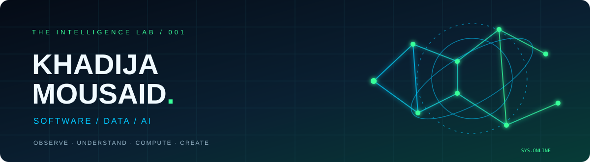
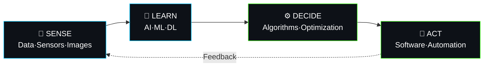
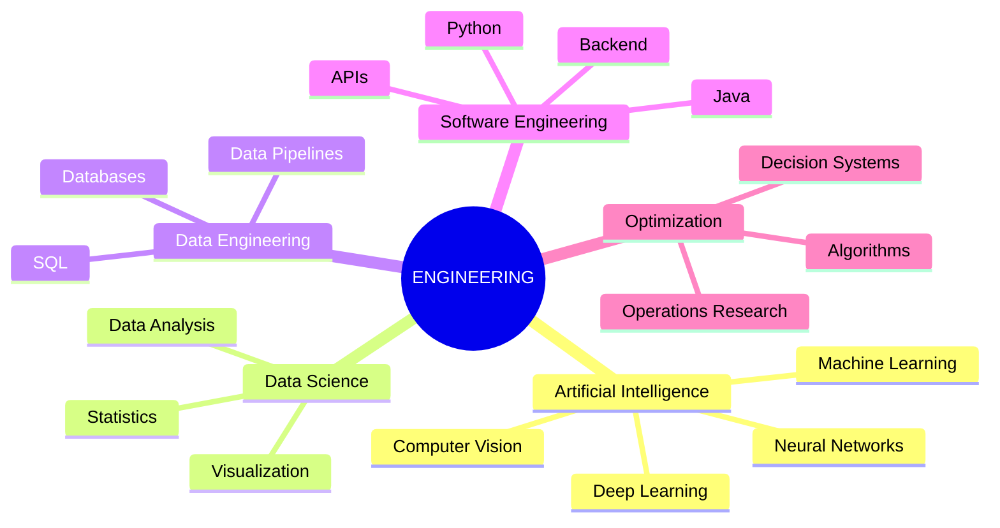

<div align="center">



<br/>


<br/>


</div>

---

## ⏻ `01` — SYSTEM PROFILE

```text
[  OK  ] Identity ............. Khadija Mousaid
[  OK  ] Education ............ Engineering Student — IDSI
[  OK  ] University ........... FST Mohammedia · Université Hassan II
[  OK  ] Specialization ....... Data Science & Computer Engineering
[  OK  ] Interests ............ AI · ML · DL · Data Engineering
[  OK  ] Technologies ......... Python · Java · SQL · PyTorch
[  OK  ] Mindset .............. Learn → Experiment → Build
[  ..  ] Searching ............ Internship opportunities
```

I'm an engineering student passionate about **Artificial Intelligence, Data Science and Software Engineering**.

I enjoy exploring algorithms, understanding how intelligent systems work, and transforming data into meaningful solutions.

My goal is to build applications that can **learn, analyze, optimize and make intelligent decisions.**

---

## 🧠 `02` — THE INTELLIGENCE PIPELINE

<div align="center">


</div>



| Layer | Exploration |
|---|---|
| 📡 Data | Collection, preprocessing, analysis and visualization |
| 🧠 Intelligence | Machine Learning, Deep Learning and Computer Vision |
| ⚙️ Optimization | Algorithms, statistical learning and decision systems |
| 🚀 Engineering | Applications, databases, APIs and automation |

---

## 💻 `03` — TECHNOLOGY ECOSYSTEM

### 🧠 Data Science & Artificial Intelligence

<div align="center">


<br/>


</div>

### 💻 Programming & Software Engineering

<div align="center">


</div>

### 🗄️ Databases & Data Engineering

<div align="center">


</div>

### ⚙️ Tools & Environment

<div align="center">


</div>

---

## 🧪 `04` — EXPERIMENT LAB

<details>
<summary><b>📦 EXP-03 — SmartLogi (loading...) </b> | Intelligent Logistics Optimization</summary>

<br/>

**Mission:** Optimize order fulfillment using multiple warehouses.

- PostgreSQL relational database.
- Multi-warehouse stock allocation.
- Multi-criteria optimization.
- Logistics planning and route considerations.

`Python` `PostgreSQL` `Algorithms` `Optimization`

</details>

<details>
<summary><b>🔬 EXP-04 — ScientificLab</b> | Full-Stack Development</summary>

<br/>

**Mission:** Build a collaborative laboratory management application.

- Backend and database architecture.
- Web interface development.
- Collaborative software engineering.

`Java` `React` `MySQL`

</details>


<details>
<summary><b>🚗 EXP-05 — Intelligent Parking System</b> | Java & OOP</summary>

<br/>

**Mission:** Organize parking operations through object-oriented programming.

- Object-oriented design.
- HashMap and data structures.
- Custom exception handling.

`Java` `OOP` `HashMap`

</details>


<details>
<summary><b>🌱 EXP-01 — AI Plant Disease Detection</b> | Deep Learning & Computer Vision</summary>

<br/>

**Mission:** Teach a machine to recognize plant diseases from leaf images.

- CNN-based image classification.
- Image processing using OpenCV.
- Deep Learning with PyTorch.
- Flask application and SQLite database.

`Python` `PyTorch` `OpenCV` `Flask` `SQLite`

</details>

<details>
<summary><b>💧 EXP-02 — AquaSmart</b> | AI & IoT Smart Irrigation</summary>

<br/>

**Mission:** Make irrigation smarter using sensors and connected systems.

- ESP32-based hardware architecture.
- Soil moisture and environmental monitoring.
- Automated irrigation decisions.
- Water management and optimization.

`ESP32` `IoT` `Sensors` `Automation`

</details>


---

## 🌳 `05` — SKILL TREE



### 🎮 Current Quests

- [ ] Machine Learning fundamentals
- [ ] Deep Learning with PyTorch
- [ ] Python for Data Science
- [ ] Advanced Java & Backend Architecture
- [ ] Data Engineering & Data Pipelines
- [ ] Intelligent end-to-end applications

---

## 📈 `06` — GITHUB TELEMETRY

<div align="center">


<br/><br/>


</div>

---

## 📡 `07` — OPEN CHANNEL

```text
$ ping khadija

64 bytes from Morocco:
status=open_to_internships
domains=AI|ML|DL|DATA|SOFTWARE
connection=READY
```

<div align="center">

<a href="https://github.com/KhadijaMousaid">

</a>

<a href="https://www.linkedin.com/in/YOUR-LINKEDIN/">

</a>

<br/><br/>


<br/><br/>


</div>
